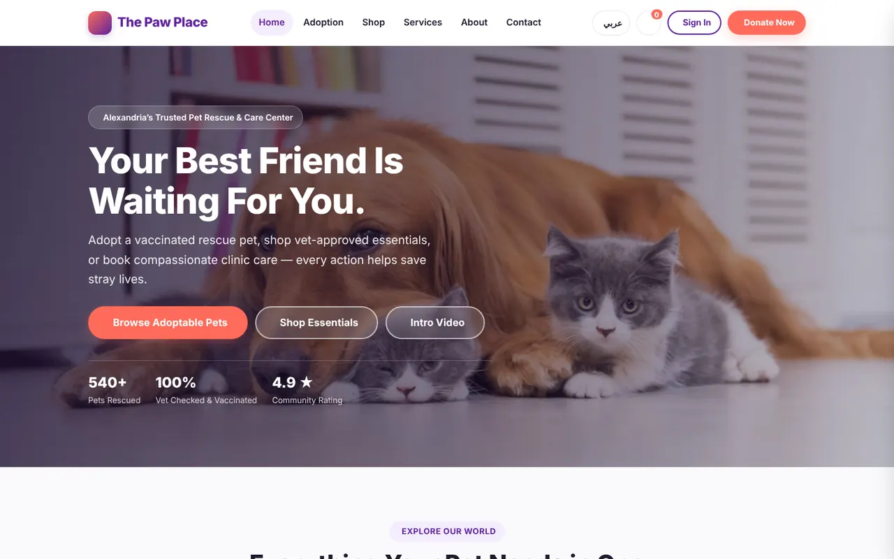

# The Paw Place 🐾

Pet adoption, essentials shop and vet care center in Alexandria, Egypt.

**Live demo:** https://pawplace.surge.sh



## Features

- Adoptable cats and dogs with detail pages and an adoption form
- Pet supplies shop with cart and checkout
- Grooming and clinic services
- Donations page and sign-in
- Arabic / English switch

## Tech stack

HTML5 · CSS3 · Vanilla JavaScript

## Run it locally

No build step — open `index.html` in a browser, or serve the folder:

```bash
npx serve .
```

---

Built by [Seif Sarhan](https://seifsarhan.github.io) · [GitHub](https://github.com/seifsarhan)
